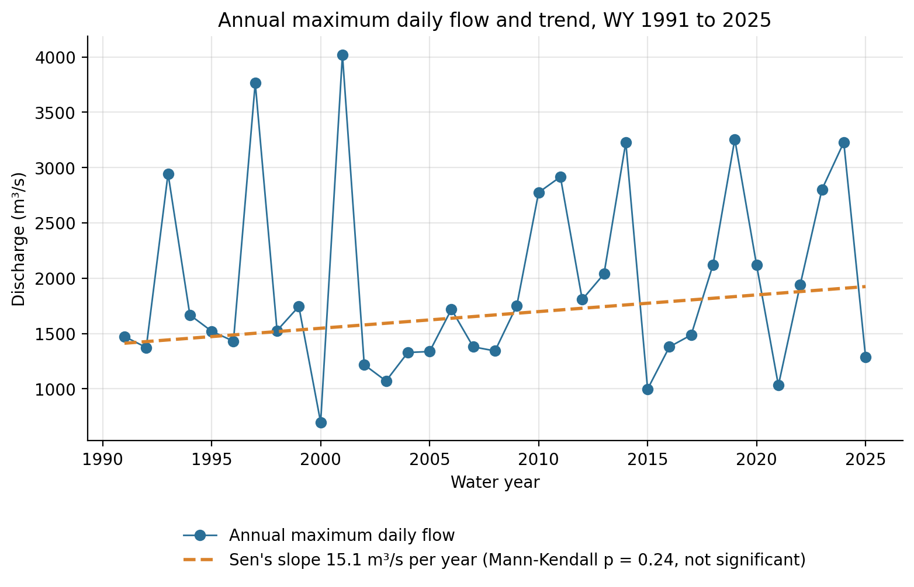

# Streamflow seasonality and trend: Mississippi River at St. Paul, MN

A small hydrology project in Python. It looks at the seasonal flow pattern of the Mississippi River at St. Paul and tests whether annual mean flow or annual flood size has changed over 35 water years (1991 to 2025).

The method follows my undergraduate thesis on river water level trends in the Sylhet basin, Bangladesh, now done in Python with open USGS data.

## Question

1. What is the seasonal flow pattern of the river, and when do annual floods happen?
2. Is there a statistically significant trend in annual mean flow or annual maximum flow over water years 1991 to 2025?

## Data

- **Station:** USGS 05331000, Mississippi River at St. Paul, MN
- **Variable:** daily mean discharge (parameter 00060, statistic 00003)
- **Period:** 1 Oct 1990 to 30 Sep 2025 (water years 1991 to 2025), 12,784 days
- **Source:** USGS Water Data API, downloaded with the `dataretrieval` Python package (`waterdata.get_daily`). The older `nwis` functions are deprecated, so the newer API is used.
- **Quality:** no missing days, no empty values, all records USGS "Approved". About 23% of days are flagged "estimated", mostly December to February, when river ice affects the gauge. None of the 35 annual peaks fall on estimated days.

A water year runs from 1 October to 30 September, so each winter's snow and the spring melt from it fall in the same year.

## Method

1. Download and clean the data with pandas (date index, unit conversion from ft³/s to m³/s, quality checks).
2. Monthly and seasonal mean flow, annual mean flow and annual maximum daily flow (pandas `groupby`).
3. Flow duration curve (Weibull plotting position).
4. Lag-1 autocorrelation check, then Mann-Kendall trend test and Sen's slope (`pymannkendall`) on annual mean and annual maximum flow.
5. Four figures with Matplotlib.

Mann-Kendall was chosen because it does not assume normally distributed data. River flow here is clearly skewed (mean 529 m³/s, median 354 m³/s). Sen's slope uses the median of all pairwise slopes, so single extreme floods do not distort it much.

## Key figure

Other figures: [hydrograph](figures/fig1_hydrograph.png), [monthly means](figures/fig2_monthly_means.png), [flow duration curve](figures/fig3_flow_duration_curve.png).

## Findings

- **Snowmelt-driven regime.** Mean flow is highest in April (1,068 m³/s) and lowest in February (208 m³/s). Spring flow is about 3.6 times winter flow.
- **Two flood types.** 23 of 35 annual peaks occurred in March to May (snowmelt) and 12 in June to September (likely rainfall).
- **Flow duration.** Q10 = 1,175 m³/s, Q50 = 354 m³/s, Q90 = 130 m³/s. High flow is about 9 times low flow.
- **No significant trend.**

  | Series | Mann-Kendall p | Kendall's tau | Sen's slope |
  |---|---|---|---|
  | Annual mean flow | 0.57 | 0.069 | +1.5 m³/s per year |
  | Annual maximum daily flow | 0.24 | 0.139 | +15.1 m³/s per year |

  Both slopes are positive, but neither can be separated from year-to-year variability at the 0.05 level. This does not prove that flow is unchanged. With 35 highly variable years, a modest real trend could go undetected.
- **Possible shift, not tested.** Annual peaks look lower in 2002 to 2009 and higher from 2010 onwards. Mann-Kendall tests for a steady monotonic trend, not a sudden shift.

## Limitations

- Only 35 years are used, although the station record is much longer. Trend results can depend on the period chosen.
- Annual peaks are maximum daily means, not instantaneous peaks.
- Winter values are largely USGS estimates because of ice, so winter means should be read with care.
- One station only, so the results say nothing about the wider region.

## Next steps

- Repeat the test over the full station record to see if the result depends on the start year.
- Apply a change-point test (for example Pettitt) to check for a shift around 2010.
- Use the USGS annual instantaneous peak flow series instead of daily maxima.
- Apply the same workflow to river water level (stage) records from Bangladesh, where discharge is often not measured.

## Files

- `01_streamflow_trend.ipynb`: full notebook with code, explanations and figures
- `figures/`: the four figures
- `results/annual_summary.csv`: yearly mean flow, peak flow, peak date, peak month and estimated flag
- `results/monthly_means.csv`: mean flow for each calendar month

## How to run

Open the notebook in Google Colab and click **Runtime > Run all**. It installs the two extra packages and downloads the data from USGS, so no data files are needed.

## About this project

Built by Imranur Rahman (BSc Agricultural Engineering, Sylhet Agricultural University) using library documentation, tutorials and AI-assisted coding. I have gone through every line of the code and can explain the methods and results.
